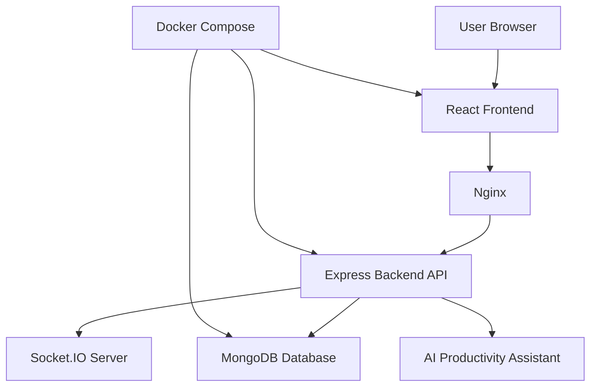

# 🚀 TeamTracker — Team Collaboration & Project Management Platform

**TeamTracker** is a full-stack team collaboration and project management platform designed to help teams organize projects, manage tasks, track progress, and collaborate in real time. It features role-based access control, live collaboration, analytics dashboards, and an AI-powered productivity assistant.

Built using the MERN-style stack with Docker-based deployment, TeamTracker provides a scalable and modern SaaS-style experience.

---

## ✨ Features

### 🔐 Authentication & Role-Based Access Control (RBAC)
- Secure JWT-based authentication.
- Password hashing using bcryptjs.
- Three user roles: Admin, Team Leader, and Team Member.
- Public registration restricted to Team Member accounts.
- Role-based access to protected routes and resources.

### 📊 Modern SaaS Dashboard
- Overview of project and task statistics.
- Task completion analytics.
- Project progress tracking.
- Team activity feed.
- Interactive charts and visual reports.

### 📋 Advanced Task Management
- Drag-and-drop Kanban board powered by `@dnd-kit`.
- List-based task management.
- Task priority and status management.
- Filtering and task organization.
- Task comments and collaboration.
- Real-time task updates.

### 💬 Real-Time Collaboration
- Project-based chat channels.
- Real-time communication powered by Socket.IO.
- Live task updates.
- Notifications for team activities.

### 🤖 AI Productivity Assistant
- Context-aware project insights.
- Overdue task identification.
- Workload analysis and recommendations.
- Productivity suggestions for better project management.

### 🛡️ Admin Control Panel
- User management.
- Activate or deactivate accounts.
- Role assignment and management.
- Audit log monitoring.

### 🎨 Modern User Interface
- Responsive dashboard design.
- Dark and light mode.
- Persistent theme preferences.
- Modern UI with interactive components.

---

## 🛠️ Tech Stack

| Layer | Technologies |
|---|---|
| Frontend | React 18, Vite |
| Styling | Tailwind CSS |
| Routing | React Router |
| HTTP Client | Axios |
| Icons | Lucide React |
| Charts | Recharts |
| Drag & Drop | @dnd-kit |
| Real-Time | Socket.IO Client |
| Backend | Node.js, Express.js |
| Database | MongoDB, Mongoose |
| Authentication | JWT, bcryptjs |
| Real-Time Server | Socket.IO |
| Security | Helmet, Express Rate Limit |
| Containerization | Docker, Docker Compose |
| Reverse Proxy | Nginx |
| CI/CD | GitHub Actions |

---

## 🏗️ Architecture



---

## 📁 Project Structure

```text
TeamTracker/
│
├── client/                 # React Frontend
│   ├── src/
│   ├── public/
│   ├── package.json
│   └── vite.config.js
│
├── server/                 # Node.js Backend
│   ├── routes/
│   ├── controllers/
│   ├── models/
│   ├── middleware/
│   ├── package.json
│   └── ...
│
├── nginx/                  # Nginx configuration
├── docker-compose.yml
├── .env.example
├── .gitignore
└── README.md
```

<sub>Directory names may vary depending on the implementation.</sub>

---

## 🚀 Getting Started

### Prerequisites

Make sure you have the following installed:

- [Docker Desktop](https://www.docker.com/products/docker-desktop/)
- Git
- Node.js and npm (for local development)

---

## 🐳 Run with Docker (Recommended)

### Step 1: Clone the repository

```bash
git clone <your-repository-url>
cd TeamTracker
```

### Step 2: Configure environment variables

Copy the example environment file:

```bash
cp .env.example .env
```

On Windows PowerShell:

```powershell
Copy-Item .env.example .env
```

Update the environment variables in `.env` according to your configuration.

### Step 3: Build and start the application

```bash
docker compose up --build
```

### Step 4: Access the application

Open your browser:

**http://localhost:3000**

### Step 5: Stop the application

```bash
docker compose down
```

To stop the application and remove persisted database data as well:

```bash
docker compose down -v
```

<sub>Warning: `-v` removes the associated Docker volumes and may permanently delete stored MongoDB data.</sub>

---

## 💻 Local Development

### Backend Setup

```bash
cd server
npm install
```

Configure your backend environment variables and start the development server:

```bash
npm run dev
```

### Frontend Setup

Open a new terminal:

```bash
cd client
npm install
npm run dev
```

Access the frontend using the development URL displayed by Vite in your terminal.

---

## ⚙️ Environment Configuration

The application uses environment variables for configuration.

| Variable | Description |
|---|---|
| `PORT` | Backend server port |
| `MONGO_URI` | MongoDB connection string |
| `JWT_SECRET` | Secret key used for JWT authentication |
| `JWT_EXPIRES_IN` | JWT expiration configuration |
| `NODE_ENV` | Application environment |
| `CLIENT_URL` | Frontend URL for configuration or CORS, if used |

<sub>Variable names must match those defined in your actual `.env.example` and application configuration.</sub>

---

## 🧪 Testing

Run backend tests:

```bash
cd server
npm test
```

Testing helps validate backend functionality, API behavior, and application logic.

---

## 🔒 Security Features

- JWT-based authentication.
- Password hashing with bcryptjs.
- Role-based authorization.
- Helmet security headers.
- Express rate limiting.
- Protected API routes.
- Restricted public role assignment.

---

## 📦 Deployment & DevOps

TeamTracker supports containerized deployment using Docker and Docker Compose.

- **Docker:** Containerizes application services.
- **Docker Compose:** Orchestrates frontend, backend, and database services.
- **Nginx:** Reverse proxy and frontend serving configuration.
- **GitHub Actions:** Continuous integration workflow automation.

---

## 🎯 Project Goals

- Simplify team project management.
- Improve task tracking and accountability.
- Enable real-time collaboration.
- Provide actionable productivity insights.
- Demonstrate modern full-stack development and DevOps practices.

---

## 🔮 Future Enhancements

- Email notifications.
- Advanced project reporting.
- File attachments for tasks.
- Calendar integration.
- Team performance analytics.
- Automated deployment pipelines.
- Enhanced AI-based task planning.

---

## 👨‍💻 Author

Developed as a modern full-stack team collaboration and project management platform.

---

**TeamTracker — Plan. Track. Collaborate. Deliver.**
